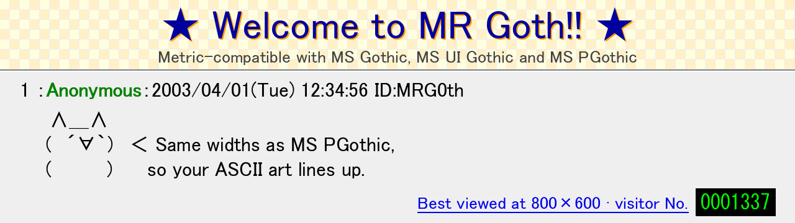

# MR Goth



MR Goth, MR UI Goth and MR PGoth are metric-compatible replacements for MS
Gothic, MS UI Gothic and MS PGothic, covering their Latin, Greek, Cyrillic
and symbol glyphs: 2,217 characters per face, without kana or kanji. Each
glyph has the original's advance width, vertical metrics and character
mapping, and the fonts carry the original's layout behaviour (vertical
forms, `ccmp`), so text set in MS Gothic keeps its line breaks and glyph
positions. The outlines are traced from renders of the original, not
copied from it.

This is version 0.1, checked against MS Gothic 5.31.

## Faces

| Face | Name | Japanese name | PostScript name | Widths |
|---|---|---|---|---|
| 0 | MR Goth | ＭＲ ゴス | MR-Goth | half-width 128 and full-width 256, like MS Gothic |
| 1 | MR UI Goth | MR UI Goth | MR-UIGoth | proportional, like MS UI Gothic |
| 2 | MR PGoth | ＭＲ Ｐゴス | MR-PGoth | proportional, like MS PGothic |

All faces use 256 units per em, ascent 220 and descent -36. As in the
original, the UI face keeps its Latin name in its Japanese records, and it
differs from the P face only in a few glyphs among these (its kana, which
are out of scope, are where the two mainly differ). For Japanese text,
pair the fonts with a font that has kana and kanji, for example through the
system's font fallback.

## Repository contents

| Path | Contents |
|---|---|
| `fonts/mrgoth.ttc` | The fonts: a TrueType collection with all three faces. |
| `fonts/mrgoth.bitmaps.json` | The manifest `tools/add_ms_bitmaps.py` reads (hashes, no pixel data). |
| `src/MRGoth.ufo` | The source: one glyph pool for all faces, quadratic outlines on the 256 grid. |
| `data/` | Everything the build takes from the original font (see below). |
| `tools/` | Build, tracing, comparison and patch scripts (see below). |
| `docs/banner.png` | The header image, drawn with the fonts. |
| `OFL.txt`, `COPYING` | Licenses: OFL 1.1 for the fonts, GPL 3 or later for the tools. |

## What matches the original

- **Coverage.** The same 2,217 codepoints in each face: Basic Latin and
  Latin-1, Latin Extended-A and -B (in part), IPA, Greek, Cyrillic,
  punctuation, letterlike symbols, number forms, arrows, mathematical
  operators, technical symbols, enclosed alphanumerics, box drawing, block
  elements, geometric shapes, dingbats, CJK symbols and punctuation, and
  the full-width forms. CJK ideographs, kana, half-width katakana and the
  CJK compatibility squares are out of scope.
- **Glyph pool.** As in the original, the faces share one pool of 6,956
  glyphs. 59 codepoints use the same glyph in all three faces; for the
  others each face has its own. The pool also holds `.notdef` and the
  glyphs only layout reaches (vertical forms and `ccmp` results). Glyphs
  used by MR Goth are named after their codepoint (`uni0041`); glyphs used
  first by MR UI Goth have a `.ui` suffix, and by MR PGoth a `.p` suffix.
- **Metrics.** Every advance width, every vertical advance and vertical
  origin, and the face-level fields (`head`, `hhea`, `OS/2`, `post`,
  `gasp`, `vhea`) are the original's. Hinting never changes an advance:
  hinted advances equal the original's at every size from 8 to 72 px.
- **Layout.** `GSUB` (`ccmp`, `vert`, `jp90`), `GPOS`, `GDEF`, `BASE` and
  `meta` are the original's, per face, restricted to these glyphs.
  HarfBuzz shapes every in-scope character horizontally and vertically,
  every `ccmp` ligature and every keycap sequence exactly as it shapes the
  original.
- **Collection structure.** Tables the original stores once for several
  faces are stored once here too; MR UI Goth and MR PGoth share `OS/2`, as
  in the original.

## What differs

- **Outlines** are traced, not copied (see Method). They stay within 1 font
  unit of the original's.
- **Hinting** is by ttfautohint. The original's TrueType programs address
  its own points and cannot be reused. Hinted 1-bit renders can differ from
  the original's by single pixels, for example lowercase one pixel taller
  at 16 px.
- **No embedded bitmaps.** MS Gothic draws 10-22 px text from hand-made
  1-bit bitmaps, a separate design that no outline reproduces. These fonts
  carry none; see the next section.
- **Names and identity.** The `name` table is our own, in the original's
  layout (Macintosh English; Windows English and Japanese). Vendor ID is
  `NONE` and `fsType` is 0 (installable embedding).

## Adding Microsoft's bitmaps

If you have MS Gothic (`msgothic.ttc` from Windows), you can copy its
bitmaps into your own copy of MR Goth:

```
.venv/bin/python tools/add_ms_bitmaps.py fonts/mrgoth.ttc /path/to/msgothic.ttc
```

This writes `fonts/mrgoth-ms.ttc` with all 39,195 bitmaps for these glyphs
at 10-22 px. Each bitmap is found by the original's glyph ID (or, failing
that, by character) and copied only if it matches the hash in the
manifest; a font of the wrong family is refused. The `msgothic.ttc` that
Wine and Proton ship is Ume Gothic under that name, not Microsoft's font,
and is refused too. The patched font takes the original's `fsType` and
contains Microsoft's data: it is for your own use, not for redistribution.
The script needs only fontTools and freetype-py.

## Building

Python dependencies are in `pyproject.toml` and `uv.lock`; `uv sync`
creates `.venv`. Then

```
.venv/bin/python tools/build.py
```

writes `work/mrgoth.ttc` and its manifest from `src/` and `data/`. The
build is deterministic and does not need the original font.

The tools that read the original look for your own copy at
`reference/msgothic.ttc`, which is not part of this repository. Tracing
also needs the `potrace` binary.

| Script | What it does |
|---|---|
| `tools/build.py [--bitmaps none\|copy\|hinted\|unhinted] [--no-hinting]` | Builds the collection. `none` (the default) is the release build; `copy` adds the original's bitmaps through `add_ms_bitmaps.py`; `hinted` and `unhinted` fill the strikes from our own outlines, for comparison. |
| `tools/add_ms_bitmaps.py FONT.ttc MS.ttc [-o OUT.ttc]` | Adds Microsoft's bitmaps from your own copy of the font, checked against the manifest. |
| `tools/validate.py BUILT.ttc [--only U+0021-U+007E] [--faces 0]` | Checks a built collection against the original (see Validation). Exits 1 on any failure; details in `work/validate-report.tsv`. |
| `tools/sheet.py BUILT.ttc CHARS... [--face N] [--hinted]` | Draws the original, ours and an overlay for each glyph to `work/sheet.png`. |
| `tools/trace.py CHARS... [--face N] [--into-ufo]` | Traces glyphs of the original (characters, or pool names prefixed with `/`) and reports their distance from it; `--into-ufo` stores the result, with any non-default settings recorded in the glyph's lib. |
| `tools/derive.py` | Fills glyphs of later faces whose original outline equals an earlier face's, unchanged or moved horizontally, from our trace. |
| `tools/mkufo.py [--update]` | Creates the UFO from the manifest: every pool glyph with its advance and no outline. |
| `tools/manifest.py` | Writes the manifest in `data/` from the original. |
| `tools/snapshot.py` | Writes `data/layoutN.ttx` and `data/bitmaps.json` from the original. |
| `tools/common.py` | Shared definitions: the project, scope, rendering helpers. |

### data/

- `cmap.tsv`: face, codepoint, character, glyph and original glyph ID
  (6,651 rows, 2,217 per face).
- `glyphs.tsv`: one row per pool glyph: advance, bounds, contour and point
  counts, how a glyph of a later face relates to its counterpart in an
  earlier one (same, shifted, reshaped, redrawn), how layout reaches the
  glyphs no codepoint maps, the strikes that hold a bitmap, and vertical
  advance and origin.
- `bitmaps.tsv`: one row per glyph per strike (39,195): bitmap box,
  advance, inked pixel count, and the strike whose image it reuses.
- `strikes.tsv`: the line metrics of each 10-22 px strike.
- `face0.ttx` to `face2.ttx`: the original's `head`, `hhea`, `maxp`,
  `OS/2`, `post`, `gasp` and `vhea` per face.
- `layout0.ttx` to `layout2.ttx`: each face's `GSUB`, `GPOS`, `GDEF`,
  `BASE` and `meta`, mapped to our glyph names.
- `bitmaps.json`: the bitmap manifest: the original's family name, the
  strike line metrics, and for each bitmap our glyph, the size, the
  original face and glyph ID, a character mapped to it and a 64-bit hash of
  its pixels and metrics.

## Method

Each glyph is rendered from the original at 8 pixels per font unit, traced
with potrace, simplified (near-straight curves straightened, points added
at extremes), converted to quadratic curves and rounded to the 256-unit
grid. Glyphs whose original outline has only straight segments are traced
as polygons. Glyphs of MR UI Goth and MR PGoth whose original outline
equals an earlier face's, unchanged or moved horizontally, are copied from
that trace; the rest are traced from their own face. The traced outlines
carry about 1.2 times the original's points.

## Validation

`tools/validate.py` compares a built collection with the original. A glyph
passes when:

- its advance, vertical metrics and character mapping are the original's;
- no point of either outline is more than 1.0 font unit from the other
  (both rendered at 4 px per unit);
- its ink bounds are within 2 units of the original's;
- rendered by FreeType at 12, 16, 24 and 48 px, its coverage differs from
  the original's by at most 1.5 units of edge displacement;
- where the original is all straight segments, ours is too, and where
  every segment is horizontal or vertical (box drawing, block elements)
  ours renders identically;
- its hinted advance equals the original's at 8-72 px, 1-bit or grey as the
  original's `gasp` selects.

It also checks the face-level fields, glyph sharing between faces, table
sharing in the collection, HarfBuzz shaping, and on a patched build every
bitmap pixel for pixel.

The release build passes with zero failures: 7,094 glyph comparisons
(6,651 mapped codepoints plus `.notdef` and the layout-only glyphs each
face uses), 28,376 renders, 3,036 straight-edge checks, 26,664 shaping
comparisons and the face and table checks. A patched build also passes all
92,222 bitmap comparisons.

## License

The fonts are licensed under the [SIL Open Font License 1.1](OFL.txt),
"Copyright 2026 The MR Goth Project Authors", with no Reserved Font Name.
The tools in `tools/` are licensed under the GNU General Public License,
version 3 or later ([COPYING](COPYING)).

The outlines are traced from renders of MS Gothic, not copied from its
point data; metrics and layout rules are copied, as metric-compatible fonts
do. This rests on typeface designs being unprotected in the US and
protected in Japan only for exceptional originality. MS Gothic, MS UI
Gothic and MS PGothic are trademarks of the Microsoft group of companies
and are named here only to state compatibility.

## See also

[MR Mincho](https://github.com/laplaces-agent/mrmincho): the same for MS
Mincho and MS PMincho, built with the same tools.
